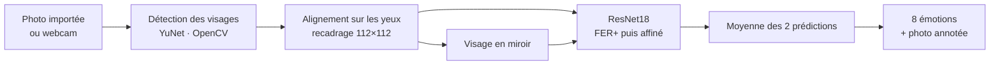

# Détection d'émotions faciales

🔗 **Démo en ligne : https://detection-emotions.streamlit.app**


Application web qui reconnaît l'émotion exprimée par un visage à partir d'une photo importée
ou prise avec la webcam.

## Fonctionnalités

- Analyse d'une photo importée (JPG, PNG, WEBP) ou prise avec la webcam
- Détection automatique de tous les visages présents sur la photo (jusqu'à 8)
- Reconnaissance de 8 émotions : **Neutre, Joie, Surprise, Tristesse, Colère, Dégoût, Peur, Mépris**
- Photo annotée avec les visages numérotés quand il y en a plusieurs
- Correction automatique de l'orientation des photos de téléphone

## Comment ça marche



1. **Détection des visages** : le détecteur YuNet (OpenCV) repère chaque visage et ses points clés
   (yeux, nez, bouche).
2. **Alignement** : chaque visage est redressé et recadré pour que les yeux soient placés comme dans
   les images d'entraînement (FER2013).
3. **Classification** : un réseau **ResNet18** (PyTorch), entraîné sur FER+ puis affiné, prédit
   l'émotion ; la prédiction est moyennée avec celle du visage en miroir pour plus de stabilité.

## Lancer en local

```bash
pip install -r requirements.txt
streamlit run app.py
```

L'application s'ouvre sur http://localhost:8501.

## Structure

```
app.py                  interface Streamlit et modèle de classification
face_utils.py           détection (YuNet) et alignement des visages
models/
  resnet18_emotions.pth   poids du ResNet18 entraîné
  resnet18_emotions.json  étiquettes et taille d'entrée du modèle
  face_detection_yunet_2023mar.onnx   détecteur de visages
requirements.txt        dépendances (PyTorch CPU)
.streamlit/config.toml  configuration Streamlit
```
